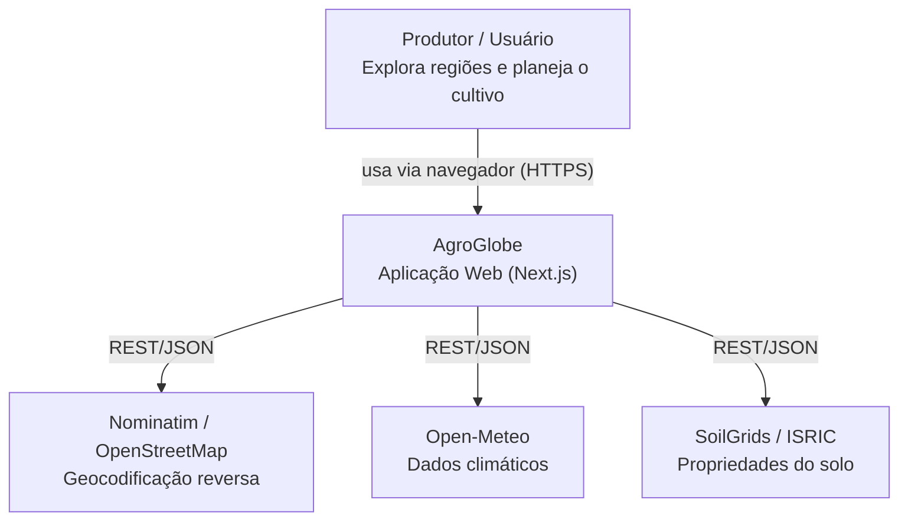
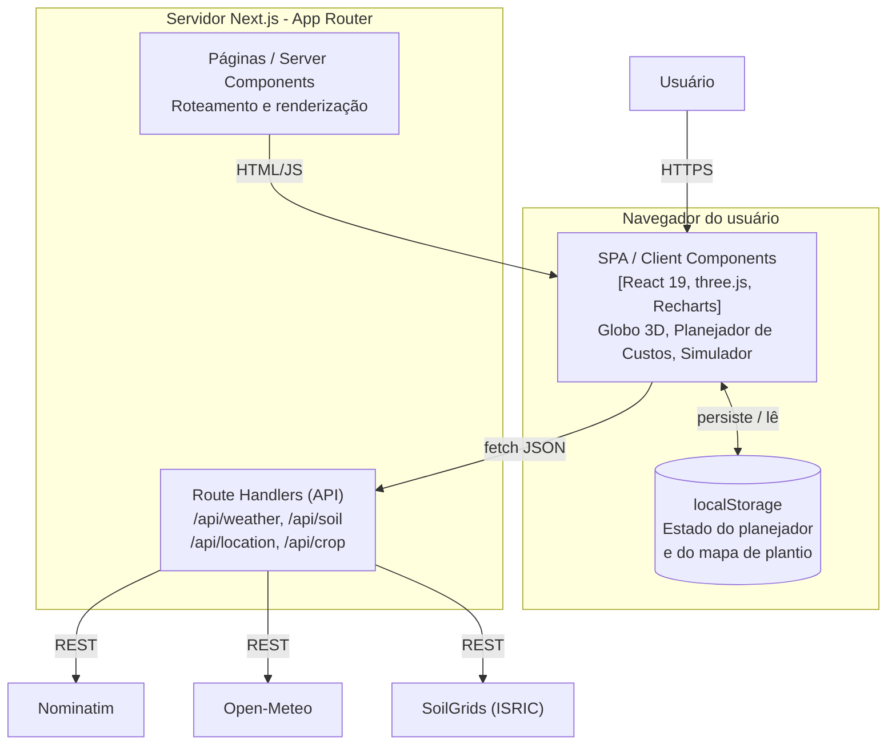
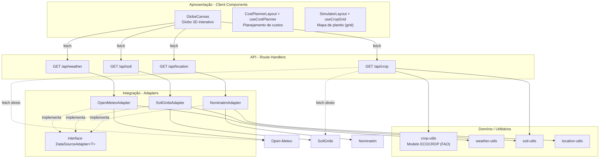

# MC656 - AgroGlobe

Repositório do projeto da disciplina **MC656 (Engenharia de Software)**.

**AgroGlobe** é uma aplicação web de exploração e planejamento agrícola. O usuário
navega por um globo 3D interativo, seleciona uma região e recebe dados de **clima**,
**solo** e **recomendações de culturas** (modelo ECOCROP/FAO), além de ferramentas
para **planejamento de custos** e para **simular um mapa de plantio**.

## Colaboradores
- Lucas Souza Guimarães - 195948
- Bruno Medeiros Saback - 281746
- Lucas Cabral Senno - 281816
- Filipe de Souza Lalic - 288884
- Lucas Valadares Lima - 247025

---

## Arquitetura

### Estilo arquitetural

O AgroGlobe é um **monólito modular full-stack** construído sobre o **Next.js (App
Router)**, no qual frontend e backend convivem no mesmo projeto e no mesmo deploy.
Internamente, o sistema segue uma **arquitetura em camadas (layered)**, organizada
por feature:

1. **Apresentação** - páginas e *Client/Server Components* do App Router, agrupados
   por funcionalidade (`globe`, `cost-planner`, `simulator`).
2. **API / Aplicação** - *Route Handlers* em `app/api/*` expõem endpoints REST/JSON,
   validam a entrada (lat/lng) e orquestram a resposta.
3. **Integração / Acesso a dados** - *adapters* em `app/lib/datasources/*` encapsulam
   cada serviço externo atrás da interface `DataSourceAdapter<T>` (**padrão Adapter**),
   isolando o restante do sistema das particularidades de cada API externa.
4. **Domínio / Utilitários** - regras puras, como o `crop-utils` (modelo de adequação
   ECOCROP da FAO) e os `*-utils` de *parsing* e sumarização das respostas externas.

**Decisões transversais:**

- **Persistência:** atualmente *client-side* via `localStorage` (estado do Planejador
  de Custos e do Mapa de Plantio). Não há banco de dados no momento.
- **Padrão de projeto em destaque:** **Adapter** (Avaliação A4 / PR #22), padronizando
  o acesso às fontes de dados externas sob uma única interface.
- **Comunicação:** navegador -> API via `fetch` (HTTP/JSON); API -> serviços externos
  via HTTPS/REST, com cache do Next (`revalidate` / `force-cache`) onde aplicável.

### C4 - Nível 1: Contexto

### C4 - Nível 2: Containers

### C4 - Nível 3: Componentes

> **Nota de evolução:** `/api/crop` ainda consulta SoilGrids e Open-Meteo diretamente
> (linhas tracejadas), enquanto os demais endpoints já passam pelos *adapters*. Reusar
> os adapters também no `/api/crop` é uma evolução natural da camada de integração.

### Descrição dos componentes e responsabilidades

| Componente | Camada | Responsabilidade |
|------------|--------|------------------|
| `Home` (`app/page.tsx`) | Apresentação | Tela inicial e navegação para Globo, Planejador de Custos e Simulador. |
| `GlobeCanvas` (`app/components/globe-canvas.tsx`) | Apresentação | Renderiza o globo 3D (react-globe.gl / three.js); ao clicar numa coordenada, dispara em paralelo `/api/soil`, `/api/weather`, `/api/location` e `/api/crop` e exibe clima, solo e sugestões de cultura. |
| `CostPlannerLayout` + `useCostPlanner` (`app/cost-planner`) | Apresentação | Gerencia itens de custo, parâmetros globais (cultura, área, moeda), cálculo de custos, gráfico de pizza (`CostPieChart`/Recharts) e exportação em PDF (`CostPlannerPDF`/`@react-pdf/renderer`); estado persistido em `localStorage`. |
| `SimulatorLayout` + `useCropGrid` (`app/simulator`) | Apresentação | Grid configurável (`CropGrid`) com paleta de culturas (`CropPalette`) onde o usuário "planta" culturas por célula; estado persistido em `localStorage`. |
| `GET /api/weather` | API | Valida lat/lng e delega ao `OpenMeteoAdapter` para retornar o clima atual. |
| `GET /api/soil` | API | Valida lat/lng e delega ao `SoilGridsAdapter` para retornar as propriedades do solo. |
| `GET /api/location` | API | Valida lat/lng e delega ao `NominatimAdapter` para geocodificação reversa (cidade/estado/país). |
| `GET /api/crop` | API | Combina solo (SoilGrids) e temperatura (Open-Meteo) e aplica o `crop-utils` (ECOCROP) para pontuar e recomendar culturas. |
| `DataSourceAdapter<T>` (`app/lib/datasources/types.ts`) | Integração | Interface comum dos adapters: `fetch(point: GeoPoint): Promise<T>`. |
| `OpenMeteoAdapter` / `SoilGridsAdapter` / `NominatimAdapter` | Integração | Implementam a interface; montam a URL do serviço externo, tratam erros e normalizam a resposta (delegando aos `*-utils`). |
| `crop-utils` (`app/api/crop`) | Domínio | Modelo de adequação **ECOCROP (FAO)**: classifica a textura do solo, pontua e recomenda culturas a partir de temperatura e pH. |
| `weather-utils` / `soil-utils` / `location-utils` | Domínio | *Parsing* e sumarização das respostas externas (ex.: `buildClimateSummary`, `buildSoilSummary`, `buildLocationPayload`). |

### Stack

- **Framework:** Next.js 16 (App Router), React 19, TypeScript
- **UI / visualização:** Tailwind CSS 4, react-globe.gl / three.js, Recharts, @react-pdf/renderer
- **Testes:** Jest, Testing Library
- **Fontes de dados externas:** Nominatim (OpenStreetMap), Open-Meteo, SoilGrids (ISRIC)
